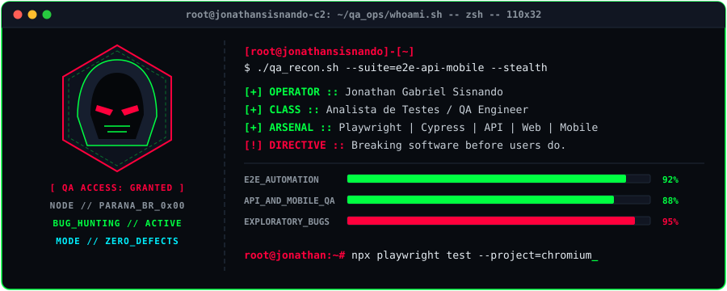

<!-- 1. BANNER PANORÂMICO DE TOPO -->

  

<!-- 2. BARRA DE STATUS & TELEMETRIA RÁPIDA -->

  
  
  

 

<!-- 3. LAYOUT DE DUAS COLUNAS COM O TERMINAL -->
<table>
  <tr>
    <td width="52%" valign="top">

### `[ 0x01 // SYSTEM_OVERRIDE ]`

- **Operação Atual:** Analista de Testes / QA focado em encontrar falhas críticas e blindar a qualidade de software antes do deploy.
- **Especialidades:** Testes Automatizados, Testes Manuais & Exploratórios, Testes Web, Mobile e de APIs REST.
- **Automação & Frameworks:** Criação de suítes resilientes E2E com **Playwright** e **Cypress**, integração em CI/CD e validação de contratos.
- **Base de Operações:** Nova Esperança do Sudoeste, Paraná — Brasil.
- **Canal Direto:** **jonathansisnando.qa@gmail.com**

 

**`> COMUNICAÇÃO CRIPTOGRAFADA:`** 

</td>
    <td width="48%" valign="middle" align="center">
      
    </td>
  </tr>
</table>

 

<!-- 4. ARSENAL & TECNOLOGIAS DE QA -->
### `[ 0x02 // QA_ARSENAL_&_PAYLOADS ]`

  
  
  
  
  
  
   
  
  
  
  
  
  

 

<!-- 5. GRÁFICO DE ATIVIDADE -->
### `[ 0x03 // EXPLOIT_TELEMETRY ]`

  

<!-- 6. RODAPÉ DE ENCERRAMENTO -->

  

